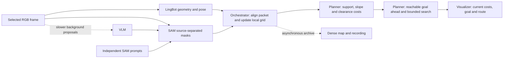

# Implementation plan: framewise traversability and a moving local goal

This is a proposed new backend, not an implemented or benchmarked real-time
feature. The agreed live behaviour is to choose a reachable traversable point
ahead of the camera and update its route as processed frames arrive. No final
destination or end-of-recording analysis is required for this mode. Application
code and the running server are unchanged; this document is the implementation
proposal. The existing exact point-cloud backend remains available offline.

## Required live behaviour

After startup/reference bootstrap, every selected complete frame packet produces
a traversability update. Enabled slope analysis and semantic sources affect its
costs immediately. The current camera pose supplies the demo's robot pose.
Choose an observed, traversable, reachable goal within a configured lookahead
distance. Publish a short route and replace it as the camera advances or relevant
geometry/semantics change. The dense accumulated cloud is a separate output.

The goal must never be manufactured on unknown, blocked, unsupported or
unreachable ground. If there is no valid start or forward candidate, publish an
explicit unavailable result. Reaching an arbitrary final-video pose and proving
the globally shortest raw-point route are outside this live mode's scope.

The path must remain connected as the video continues. Maintain a persistent
path made of a completed prefix and a currently planned suffix. Each local
update extends or replaces the suffix through an explicit shared anchor; it
must not publish disconnected independent frame routes. Camera trajectory and
planned path remain separate: observing camera motion does not establish that
the camera followed a proposed route.

## Evidence from the current implementation

The IMG_5701 recording accumulated 6,247,214 point observations. Exact search
expanded about 2.2 million vertices and took 344 seconds after optimization.
Many vertices are repeated observations of the same physical surface. Every
candidate edge performs geometric support and clearance queries. The complete
analysis is currently triggered after the recording ends.

Measured median event timings on the latest full-feature live run:

| Operation | Median |
|---|---:|
| LingBot geometry batch | 187 ms |
| SAM grouped image queries | 144 ms |
| Projection and map append | 37 ms |
| Capture/read to mapped observation | 387 ms |
| Background VLM proposal | 1,124 ms |

The run processed 112 geometry frames and 56 mapped frames in approximately
39.4 seconds before final analysis. Final status currently computes throughput
over the subsequent analysis as well, so its final geometry/mapping Hz figures
are unsuitable for measuring perception throughput. Future timing reports must
separate inference, fusion, planning, observation age, startup and export.

Moving the existing native feasible-bound calculation ahead of exact search
can produce a validated candidate in about four seconds on this saved map.
That is a useful intermediate preview, but full-map preprocessing still takes
about 86 seconds. It cannot meet the live requirement by itself.

## Planning representation

Retain the dense cloud as reconstruction evidence and a visualization/export
product. Build a separate fused terrain grid for navigation. Use cell IDs tied
to world coordinates rather than one graph vertex per input point.

Start with a bounded local window of 200 by 200 cells: 40,000 graph vertices
with at most eight neighbouring cells each. With metric calibration, a 10 m
window at 5 cm resolution is an example of that size. Current monocular maps
are in relative model units; a resolution in metres requires a scale estimate.
Otherwise configure the cell size and robot dimensions in model units and
label the output accordingly. Select resolution using minimum obstacle size,
support gaps and footprint requirements rather than performance alone.

The grid stores observed support, surface height/uncertainty, separate semantic
source layers, slope, obstacles above the surface, last observation time and
validity. Preserve distinct height layers where a cell contains multiple
surfaces. Averaging a floor, bridge and ceiling into one height is unacceptable.
The initial backend may reject ambiguous multi-layer cells rather than invent
a connection.

Conservative fusion requirements:

- Independent SAM positives, VLM positives and base support retain separate
  source channels. Positives supply traversability evidence; geometry still
  checks support and clearance.
- Negative VLM/manual masks veto overlapping positive observations, following
  the existing precedence. A small obstacle must survive cell fusion rather
  than disappear into an averaged centroid.
- Unknown space and unresolved support holes remain unavailable. Inflation and
  edge checks account for the robot footprint, cell extent, vertical clearance
  and uncertainty. Diagonal moves cannot cut blocked corners.
- Expiration of a VLM concept is not proof that a previously observed obstacle
  disappeared. Clearing obstacles requires newer contradictory evidence under
  an explicit policy. Preserve raw evidence separately from live map state.
- Slope-disabled operation omits slope gates and penalties while retaining the
  other checks. SAM/VLM/extra prompts remain independently selectable.

Use organized depth-neighbour calculations for initial local normals, or robust
fits on small grid patches. Fuse reliable estimates and update only affected
patches. This changes the slope representation from the original point-wise
fit; validate ramps, noisy terrain, boundaries, steps and holes before enabling
it by default. Missing/ambiguous slope stays unavailable when slope enforcement
is enabled.

## Incremental execution

Each completed, aligned RGB/geometry/mask packet updates the live map immediately.
Match frame IDs, source timestamps, RGB identity, geometry/reference epoch and
semantic query versions. Reuse text features, but never apply a mask from a
different image to new geometry.

The orchestrator publishes changed cells and their affected neighbourhoods.
Recompute slope, support and clearance costs inside that region. A full distance
transform on the bounded 40,000-cell window is also reasonable initially;
measure before implementing a complex incremental distance transform.

The planner reads an immutable revision of this small map in its own CPU
worker. Trigger planning when the pose, goal or relevant costs change. A bounded
native Dijkstra search supplies reachable candidates and predecessor paths in
one pass for automatic goal selection. Native grid A* is an alternative when a
goal is already fixed. Reuse valid route segments when changes are elsewhere.
Add D* Lite/LPA* only if repeated-search profiling justifies it; stable world
cell IDs are required for useful state reuse.

Global destinations and long-range routing can be added later. The first live
release uses only a moving local goal in currently observed reachable ground.
It must not read a future frame or use the final camera pose to select that goal.

The VLM updates concepts asynchronously at a slower rate. SAM applies the active
typed concepts and fixed extra queries to fresh selected images. Initially keep
GPU inference scheduling sequential/budgeted: the measured three-model peak
already approaches the 20 GB allocation, so concurrent activations need a
separate memory benchmark. CPU fusion and planning can overlap GPU inference.

For live mode, bound input queues and discard superseded pending work rather
than accumulate increasing latency. Preserve an aligned complete observation
packet; dropping unrelated stages independently can corrupt projection.
Offline replay remains lossless. File exports, large SHA verification passes,
compressed archives and point-cloud writes run outside the planning loop.
Replace worker NPZ interchange with a bounded shared-memory transport after
profiling; every slot needs ownership, revision and lifetime rules.

## Six-component ownership

| Component | Responsibility |
|---|---|
| LingBot-MAP | Current geometry, pose and confidence in its documented coordinate frame |
| VLM | Asynchronous traversable/non-traversable prompt proposals |
| SAM | Fresh source-separated base, independent positive and typed VLM masks |
| Orchestrator | Packet alignment, projection/fusion, scheduling, revisions and persistence |
| Path planner | Pure terrain-grid costs, geometric feasibility and budgeted route algorithms |
| Visualizer | Live grid/cost/route views, moving-goal marker and timing/age indicators |

The planner accepts arrays and revisions without loading models, reading videos
or depending on Viser. Grid projection/fusion belongs to the orchestrator;
numerical cost rules and route search belong to the planner. Standalone saved
grid planning and standalone cost generation remain possible.

Expose `planning.backend` as `exact_points` or `framewise_grid`. Keep all existing
VLM target and independent SAM prompt settings. Separate the computation
switches for geometry/semantics, slope, cost generation and route generation.
Grid routes must state their resolution, map revision, units, observation age
and optimality scope. They are not claims of raw-point-graph optimality.

Version the live map, route and reference calibration. A newly blocked region
intersecting the current route invalidates that route immediately. If planning
misses its budget, keep the previous route only after checking it against the
current map; otherwise publish unavailable/stop. A 10 Hz planner tick cannot
make a 2 Hz perception stream supply 10 Hz fresh obstacle information.

## Automatic goal ahead

1. Locate the current camera/robot ground projection in the local map. Associate
   it with nearby observed support under a strict distance limit. A blocked
   nearest support cell must not be skipped in favour of a farther free cell.
   If the start lacks support, return `no_valid_start`. Any optional visible-ground
   demo fallback must be explicitly labeled and cannot claim a physical robot
   connection across an unobserved gap.
2. Project the camera heading onto the reference ground plane. If that heading
   is undefined because the camera points nearly vertically, reuse a recent valid
   heading or return `no_valid_heading`. Do not invent an arbitrary direction.
3. Search the traversable component from that start with the configured edge
   checks and a fixed deadline. Collect reachable candidates in a forward cone
   and within the minimum/maximum lookahead distance. Candidates must have finite
   current costs, reliable surface height, adequate clearance and sufficiently
   recent observations. SAM's independent `path` source may guide preference;
   it cannot override a negative mask or a geometric veto.
4. Prefer progress toward the requested lookahead, then smaller lateral deviation
   and lower route cost. Penalize unstable/uncertain terrain. Choose the best
   eligible candidate with a known valid predecessor chain. A short reachable
   forward route is acceptable when the nominal horizon is unavailable, provided
   it exceeds a configured minimum useful progress and is labeled limited.
5. Retain a previous target while it remains observed, forward and reachable.
   Move it when the camera advances, turns enough, reaches the target, loses its
   support, or observes a meaningfully better candidate. Configure goal hysteresis
   in distance/angle units. Smooth visual target motion only within valid terrain;
   interpolating two valid goals through a blocked cell is prohibited.
6. Revalidate every published segment on the latest relevant grid revision. A
   new veto on the route invalidates it immediately, including during an active
   search. Return `no_goal_ahead`, `no_valid_route`, `stale_observation` or
   `deadline_exceeded` when appropriate, together with the specific reason.

The goal selector and search live inside the path planner, independent of the
viewer and model implementations. A bounded search can return a validated
budget-limited route; it must report the search scope and whether its search
completed rather than assert a global optimality proof.

## Connected path across frame updates

Maintain `PathState` with a reference epoch, immutable completed prefix, current
validated suffix, anchor location, goal, source/grid revision, and path validity.
The prefix records actual progress along a previously accepted path, not every
route that was proposed. In video demos without tracking/control feedback, only
advance progress when the observed camera/ground position lies within a
configured association tolerance of that path. Label any demo-only inferred
progress accordingly; do not claim physical execution.

Update procedure:

1. Associate the current ground position with the existing path in order, with
   limited backward/forward association ranges. Advance the completed prefix
   only through positions supported by observed progress. Reject jumps between
   nearby branches or different height layers.
2. Revalidate the uncompleted suffix against changed cells. Keep unchanged,
   still-valid sections to avoid unnecessary path motion. Select an anchor at
   the current valid join or a reachable point on the retained suffix.
3. Select the next traversable goal ahead and plan from that anchor. Requiring
   the extension to start at the same anchor supplies positional continuity.
   If the anchor falls inside a grid edge, represent the split explicitly and
   validate the resulting short segments.
4. Splice the new extension into the persistent path. Remove only redundant
   coincident join points. Check all join/connector segments using the same
   support, obstacle, slope and clearance rules. An interpolated line between
   disconnected segments is not a valid connection.
5. Publish the complete connected path and its valid local portion with one
   version. Maintain heading continuity where feasible; any smoothing must
   remain within traversable space and be revalidated. For a real robot, turn
   radius and other kinematic constraints require an explicit model.

If new evidence blocks an untravelled section, retain the historical completed
prefix and replace the affected suffix through a valid anchor. If the camera
deviates from the accepted path, construct a validated connector to the retained
path or replace its future section from the current position. When no connector
exists, stop extending and report `connection_lost`; show history separately
from the active route. Do not silently connect across unknown/blocked space.

Past positions can remain visible as history even when the live rolling window
has moved beyond them. They are not asserted to be currently traversable. Store
the prefix independently of the bounded cost grid and validate only active
connectors/future sections against current evidence. A reference/coordinate
reset must transform the complete path using a validated transform or close its
epoch and report a break; never join incompatible map coordinates.

Acceptance tests include continuity across every successful update, unchanged
prefixes, no duplicate/artificial joins, obstacle-driven suffix replacement,
camera deviation, ambiguous branch association, loss of valid start/connection,
and rolling-window/coordinate-epoch transitions. The viewer distinguishes
completed/inferred progress, the current valid planned suffix, and unavailable
or historical sections using separate styles.

## Scheduling and deadline contract

Initially select about two input frames per second and request traversability
on every selected frame (`map_step=1` in live mode). This is not a promise to
process every raw 30 FPS camera frame. Keep a capacity-one pending input slot
plus bounded in-flight work; selected processing never builds an unbounded
queue. Choose the latest aligned completed packet for fusion, while preserving
the chronological geometry sequence required by LingBot's causal state.

Do not launch dependent geometry frames concurrently or reuse the fixed NPZ
worker filenames before a previous request completes. If shared-memory transport
is added, each in-flight request owns its slot until the worker acknowledges
completion. Discard work superseded before inference; do not repeatedly cancel
in-flight inference in a way that starves the consumer of complete packets.

The map worker and planner operate concurrently with GPU inference. One map
revision is immutable for the search duration. Check incoming changes against
the returned route before publication. Unrelated revisions need not cancel a
useful result indefinitely; relevant changes require immediate invalidation and
replanning. Source timestamps distinguish the planning revision from the last
observation and drive freshness checks.

For each incoming packet, support/geometry obstacles can invalidate the existing
route before slower semantic or slope processing finishes. Publishing a replacement
requires all enabled mandatory evidence for that packet. Invalid VLM output or
missing SAM evidence must be surfaced; a failed required semantic stage is not
equivalent to an empty obstacle mask. Fixed SAM queries remain usable in VLM-off
mode, and a slower VLM refresh reuses concepts with their documented age.

Use a monotonic wall-clock deadline inside native search, together with an
expansion cap. Cancel or reject superseded jobs. Keep the previous route only
after current validation succeeds. Route unavailability changes the displayed
status immediately; an old polyline may be shown as historical, never as valid.

## Latency targets and measurement

The first release targets soft real time after model/reference warmup. Hard
real-time deadlines cannot be claimed for the present GPU inference workers.

| Measurement | Initial engineering target |
|---|---:|
| Fresh aligned traversability packets | Approximately 2 Hz, adapting to measured capacity |
| CPU grid fusion, costs, goal, route validation and publication | P95 <= 100 ms per accepted packet |
| Complete source-observation to published-route latency | P95 <= 1 second |
| Pending capture/map/search queue size | Fixed bounded size; no growth with recording duration |
| Local grid capacity | Fixed 200 x 200 cells initially |

Suggested CPU budget: grid fusion 20 ms, slope/support/clearance costs 30 ms,
reachable-goal search 40 ms, and validation/publication 10 ms. Those numbers are
budgets to test, not existing measurements. If the system cannot meet them,
profile that stage, bound its work or adjust input frequency while reporting the
changed capacity. Do not improve reported FPS by excluding dropped frames or
observation age. Report P50/P95/P99 and deadline misses for every stage.

The existing live timings include two geometry frames per mapped update.
Mapping every selected frame changes the workload and needs a new measurement.
The VLM's ~1.1 second calls are asynchronous; first semantic bootstrap is a
separate startup condition. Faster planner ticks can refresh pose/heading goals
on the latest map, but cannot claim fresher obstacle data than perception supplies.

## Proposed repository changes

All filenames and interfaces below are implementation proposals.

| Location | Proposed change |
|---|---|
| `path_planner/local_grid.py` | Pure grid cost/edge rules; frame/reference/units contracts; bounded local goal and route API |
| `path-planning/local_grid_planner.cpp` | Native array-indexed search with deadlines, predecessor output and reachable-candidate selection |
| `orchestrator/live_traversability.py` | Aligned packets, conservative bounded terrain fusion, calibration lifecycle and incremental updates |
| `orchestrator/streaming.py` | Feed live analysis before EOF; bounded CPU worker queues; route invalidation and timing events |
| `orchestrator/config.py` and planner/stream CLIs | Validate backend, grid size/resolution, lookahead, reference/footprint, deadlines and evidence dependencies |
| `visualizer/live_demo.py` | Framewise/exact mode, cost/slope layers, automatic target marker, active route, readiness/failure/age indicators |
| `visualizer/viewer_overview.py` | Separate perception rate, planner latency, map revision, goal reason, deadline misses and observation age |
| `tests/integration` and numerical/native tests | Source alignment, mask precedence, reachability, geometric cases, concurrency, deadlines and regression |

Define compact `FramePacket`, `GridRevision`, `LocalPlan` and `PathState` contracts. Packets
carry frame/RGB identity, geometry, camera pose, confidence and source-separated
masks. Grid revisions carry a reference epoch, units/resolution, bounded region,
terrain/cost arrays and source-watermark times. Local plans carry start/goal,
positions, map revision, predecessor/feasibility status, validity age and search
scope. No numerical API reads videos, loads models or imports the viewer.

Reference/scale handling is a small state machine: `warming_up`, `waiting_for_reference`,
`ready`, and `reference_changed`. Bootstrap from reliable observed support using
the selected reference source, or an explicitly supplied calibration. Cache the
reference and its epoch; normal updates or coordinate/scale resets invalidate
affected grid contents and routes. Optional bounded history helps retain recently
observed ground under the moving camera. It is limited by time and distance and
requires compatible poses; support may not be invented by extending a fitted
plane into unobserved cells. Show readiness and its reason rather than waiting
for EOF or supplying a fake reference/clearance value.

Full artifact hashing remains necessary for immutable offline archives. Live
in-memory revisions use packet identity and checked ownership/lifetime rather
than hashing the entire dense archive on each update. Optional archival export
has a bounded independent queue and reports any dropped export work separately.

## Controls and pipeline independence

The viewer's primary selection becomes `Framewise local planning` versus
`Final-map exact analysis`. The framewise mode uses the agreed automatic point
ahead. Keep independent computation switches for SAM, base support, extra SAM
traversability, VLM and its target, slope, cost map and path planner. Cost-only
mode continues updating without selecting a goal or searching a route.

Slope-off framewise mode retains observed support, gaps, obstacles and clearance
while omitting slope gates and slope penalties. VLM-off mode can use base support
and independent SAM `path` queries. Support may also come from a validated saved
packet/grid for standalone operation. Enabling routing must require a cost map
and some positive support evidence; no mandatory model is silently enabled.

Dense recording/export remains optional in live mode. Selecting framewise mode
must not automatically run the old final-map analysis after EOF. Exact offline
comparison is a separate explicit action. This prevents an unexpected multi-minute
phase after the final live update.

## Implementation sequence and measurable gates

1. **Define contracts and replay chronological saved frame packets.** Use the
   already recorded IMG_5701 predictions/masks as input, without reconstructing
   them again. Replay prefixes and verify that each result uses only evidence
   available up to that frame. Establish a timing/validity trace.
2. **Build conservative bounded terrain and costs.** Implement the numerical
   grid and orchestrator fusion adapter. Measure full per-packet CPU costs and
   validate semantic overlap, unknown cells, small obstacles, support holes,
   ramps, steps and overhangs. Invalid multi-level cells stay unavailable.
3. **Implement moving-goal selection and native bounded search.** Verify that
   each target has finite costs and a valid route from the observed start.
   Test camera turns, forward dead ends, changing goal reachability, goal
   hysteresis and continuous path splicing. Meet the <= 100 ms combined CPU
   target on saved packets.
4. **Integrate before EOF and expose live viewer controls.** Enable map_step=1
   for selected live frames, bounded scheduling and asynchronous exports. The
   viewer must show several distinct updated routes while the video is still
   processing. Preserve masks/prompts, slope-off and cost-only modes. Benchmark
   the real three-model pipeline on the available 20 GB shard. Use paced video
   replay and its known source clock to measure latency against an actual input
   stream, not only the instant a delayed decoder reads a frame. Repeat with a
   live camera if available. Record capture, queue, inference, fusion, cost,
   search and publication timestamps on compatible monotonic clocks.
5. **Validate long-running and failure behaviour.** Confirm fixed grid/queue
   bounds, no increasing route age, immediate invalidation, correct timeout
   status and recovery from missing evidence or reference resets. Test at least
   the ordinary ground, obstacle, steep terrain and no-forward-path cases.
6. **Tune only the remaining measured bottleneck.** Consider shared memory,
   organized-depth slopes, inference acceleration or incremental search reuse
   based on the timing trace. Higher 5–10 Hz planner ticks are a later target;
   fresh perception update frequency remains separately reported.

Release acceptance: after warmup, the agreed moving-goal route is updated during
the recording, targets never appear on blocked/unknown/unreachable cells, the
published path remains connected through validated joins, the P95 CPU and
end-to-end budgets are measured, and memory/latency remain bounded
over recordings substantially longer than the existing 26-second example.
Publish observed numbers and misses; do not label the mode real time based only
on a small standalone search benchmark.

These frequencies and latency limits are engineering targets, not measured
results. Cold model loading and missing reference/scale calibration are separate
startup conditions. Real robot footprint/kinematic constraints require explicit
configuration; the existing camera-relative clearance model is not a calibrated
robot body model.

## Pre-implementation benchmark gate

Before integrating application code, run experimental CPU-only prototypes outside
the repository against the saved IMG_5701 stream and IMG_5516 real-model outputs.
Keep the running server unchanged. Save executable scripts, input fingerprints,
settings, timing samples and results. Compare original framewise slope/cost work,
organized-depth surface estimation, conservative local grid construction, goal
selection and bounded native search. Include VLM-negative plus independent SAM
positive masks, VLM-positive masks, slope-off behaviour, disconnected/unknown
ground and obstacles inserted into an existing route.

Measure projection/read costs separately from in-memory analysis. Replay frames
chronologically, state clearly when calibration is supplied, and distinguish
per-frame snapshots from temporal fusion. Measure latency distributions and
route/goal validity rather than claiming a production real-time backend from
fast search alone. Reject methods that lose negative evidence, bridge unknown
space, invent start connections, fail route continuity, or exceed their budgets.
Revise implementation choices and acceptance targets using those results before
starting application changes.

### Decisions from the saved-data benchmarks

See [FRAMEWISE_BENCHMARKS.md](FRAMEWISE_BENCHMARKS.md) for measured results.
Use an initially fixed-capacity grid with original observed point representatives.
Generate approximate grid slope costs cheaply, then refine the original robust
slope estimator only at proposed route points. Reject/refine the route when
those checks fail. Keep source/frame identity with each representative and cache
its observation-specific slope results; geometrically coincident measurements
from different frames must not silently share one slope estimate.

Native bounded search is sufficiently fast in the prototype; further global
search optimization is not the first implementation priority. Single-frame
grids and blindly appending from the last target did not sustain a connected
path on the recorded viewpoint sequence. Persistent terrain, stable anchors,
actual progress association and replacement of invalid future suffixes are
required. Lookahead must account for the camera's visible-ground range and
configured units, not assume a fixed distance that has no observed support.

Avoid refitting normals at every image point, rebuilding a concatenation of
recent point clouds each frame, or reconstructing an all-history validation
tree per update. Keep spatially indexed bounded evidence and validate the local
route corridor. Preserve enough support/obstacle witnesses to retain geometric
checks; indexing may narrow candidates but may not discard relevant negative
observations. Indexed corridor extraction matched the original full-context
geometry predicate in the tested cases.

The refined same-frame prototype met the 100 ms CPU target. The temporal
experiment did not yet meet that target or demonstrate reliable connected
navigation. Its next development gate is a causal rolling-map replay with a
validated current-ground start and connected suffix updates. End-to-end latency
with the real models must be measured separately before claiming real time.

## Primary references

The design can be implemented within this repository without requiring a ROS
migration. Relevant established patterns and algorithm references:

- [Nav2 costmap configuration](https://docs.nav2.org/rolling/configuration_and_development/configuration_guide/core_servers/costmap_2d/): bounded rolling windows and selectable resolution/update frequency.
- [Nav2 costmap layers](https://docs.nav2.org/jazzy/tutorials/plugin_tutorials/writing_new_costmap2d_plugin/writing_new_costmap2d_plugin/): bounds limiting work to changed regions.
- [Smac planner implementation](https://github.com/ros-navigation/navigation2/blob/main/nav2_smac_planner/README.md): native cost-aware grid and kinematic search backends. Its published timings are not predictions for our pipeline.
- [D* Lite paper](https://www.cs.cmu.edu/afs/cs/Web/People/maxim/files/dlite_icra02.pdf): incremental heuristic search reusing state when edge costs change.
