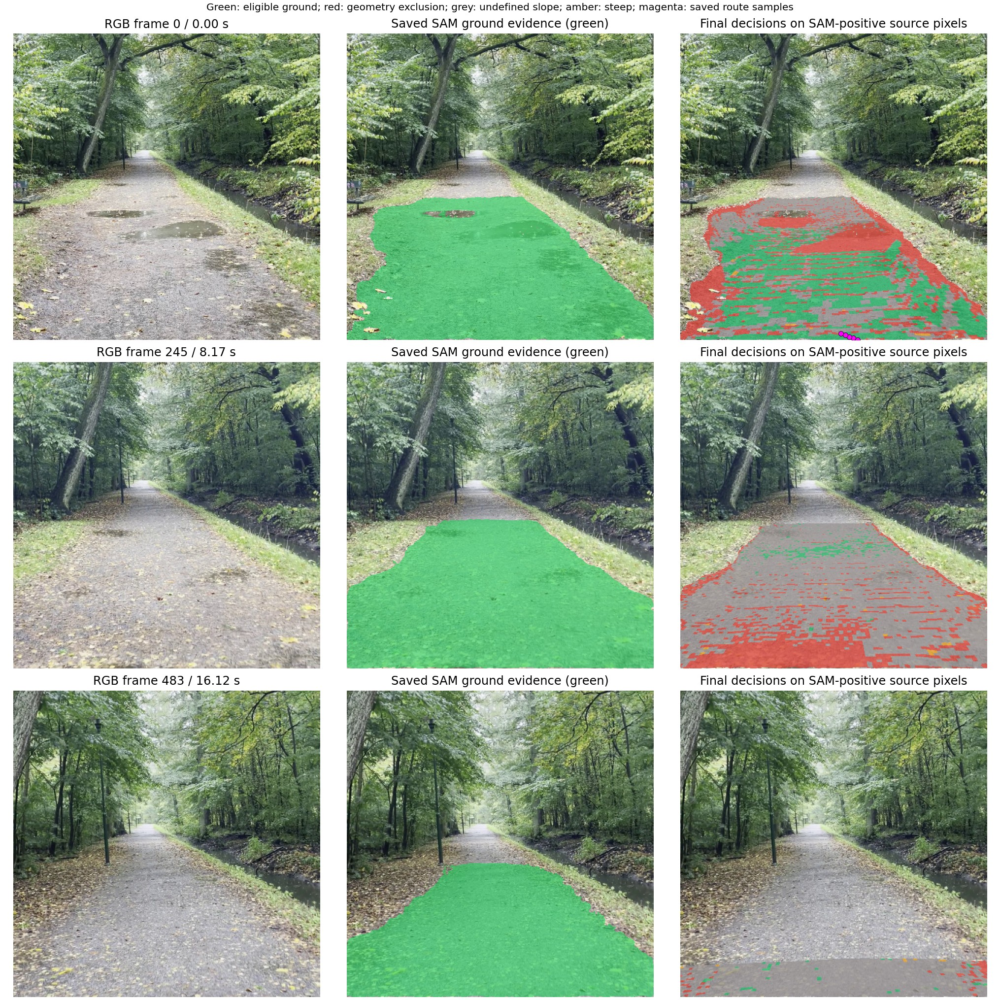

# SAM-only image, map and path-decision analysis

Analysis date: 2026-10-14. Branch: `full-integration`.

These measurements describe the **baseline before the terrain fixes**. The
subsequent sparse source-frame slope screen, terrain refresh, depth-ray recovery,
reason colors and validated partial-route fallback are documented in
[Live local planning](LIVE_LOCAL_PLANNING.md#sam-only-fix-checks-2026-10-14).

The excessive red terrain is primarily a disagreement introduced after SAM:
the fused grid rejects much of the ground that individual source frames describe
as gently sloped. Changing the color alone would conceal the planning problem.
Fixing the slope calculation alone also does not produce a complete validated
route: frame-to-frame height seams, persistent geometry exclusions and endpoint
selection have independent effects.

## Evidence and scope

Two existing complete fast-final recordings were analyzed:

| Recording | Saved run | Projected packets | Source frames inspected | Saved result |
|---|---|---:|---|---|
| Path junction / narrow side trail | `IMG_5700_ff81a8a67874` | 59 | 0, 203, 406 | No connected final route |
| Straight gravel path with puddles | `IMG_5702_f2c75f2802a7` | 70 | 0, 245, 483 | Validated partial route, 5 vertices |

Both configurations used SAM with the single support query `ground`, VLM
disabled, no manual obstacle queries and no extra traversability queries. All
archived positive masks exactly equal `base_support_mask`; all negative masks
are empty. The recorded VLM-call count is zero. Slopes, costs and final planning
were enabled. This isolates SAM-only perception followed by geometry and planning.

The RGBs were decoded again with the production resize/crop and their SHA-256
digests checked against the saved frame events. Every one of the six images
matched. The final grid was reconstructed with the recorded reference, radius,
clearance height, resolution and original source packets. Retained representative
coordinates and baseline slopes match the saved display arrays, including NaNs.

Historical full image masks were not retained for these runs. Historical SAM
overlays show the archived SAM-positive pixels that also passed depth/confidence
filtering; they must not be interpreted as full-resolution segmentation recall.
The complete last-frame SAM masks were also inspected separately. No new model
inference or complete pipeline run was performed. Alternative route candidates
were checked using the existing raw geometry validator where described below.
Production code, viewer settings and the running server were not changed.

## Images versus decisions

[Straight-path RGB / SAM / final-decision comparison](analysis/sam_only/IMG5702/image_decision_comparison.jpg)

The visible central path is broadly selected by SAM. Puddles and path margins
introduce some real semantic uncertainty; the images do not establish that every
selected pixel is physically traversable. Nevertheless, broad grey bands and
scattered rejected ground appear on the reconstructed path where the source
images show a continuous path. At the middle sampled frame, 72,871 archived
SAM-positive pixels inside the final-grid bounds map to cells with undefined
slopes; only 2,351 map to eligible cells. This is a substantial loss after SAM.

The five magenta samples at the bottom of the first image are the original
source-pixel locations of the saved validated route representatives. The route
stays near the initial observed ground and does not follow the recording to its end.

[Junction RGB / SAM / final-decision comparison](analysis/sam_only/IMG5700/image_decision_comparison.jpg)

SAM selects the wide path initially, a smaller region while the camera turns,
and the narrow connecting trail near the end. The middle frame also contains a
separate visible path that is not covered by the archived ground evidence.
Historical full masks are unavailable, so this could reflect a segmentation
omission or depth/confidence filtering. An additional positive `path` query is
worth comparing if the raw SAM mask also omits that branch. The final image
includes a step/slab and vegetation at the edges,
so some exclusion there may be appropriate. However, the planner also fragments
the interior of the SAM-selected trail into alternating allowed and excluded strips.

Decision colors in these diagnostic images differ from the live viewer:
green = eligible; grey = undefined slope; amber = estimated slope at least 30°;
red = geometry exclusion, including occupancy, current conflicts and clearance.
They show the final map's decision at each archived ground point's XY cell;
they are not a new prediction of that frame. Pixels without archived ground or
outside the final-grid bounds retain their original RGB. Multiple pixels can
project into one grid cell, so pixel counts and grid-cell counts differ.

## Where the ground disappears

| Stage / reason, in observed grid cells | Junction | Straight path |
|---|---:|---:|
| Retained observed ground representatives | 34,509 | 33,731 |
| Eligible before slope estimation | 14,985 | 25,233 |
| Undefined slope: fewer than six local samples | 1,198 | 1,501 |
| Undefined slope: fails local planarity cutoff | 8,299 | 17,757 |
| Defined grid slope at least 30° | 78 | 90 |
| Eligible after baseline slope calculation | 5,410 | 5,885 |
| Eligible in saved result after route-validation retries | 5,410 | 5,878 |

The two undefined-slope counts are mutually exclusive. No additional
identifiability failures occurred among patches with six or more samples.
Seven straight-path cells were subsequently excluded during the saved route's
validation retries, explaining the difference between 5,885 and 5,878.

In the viewer, every infinite cost is painted red. This combines missing slope
evidence, estimated steepness, geometry conflicts, occupancy and retry exclusions.
It does not mean that SAM identified all those cells as obstacles. There are
**zero explicit semantic negative cells** in both runs.

## Cause 1: slope estimation on a mixed-frame grid

`grid_pca()` estimates a plane from at most nine neighboring retained grid points.
Those points may come from different video frames. The organized PCA helper
requires at least six samples and also requires the smallest covariance
eigenvalue to be at most 0.05 times the middle eigenvalue. If that flatness test
fails, the slope becomes NaN and the grid cell gets infinite cost.

For the straight path, the flatness cutoff alone rejects 17,757 cells: about 70%
of the ground that passed pre-slope checks. Most patches contain nine samples,
so lack of samples is the smaller problem. The cutoff measures local surface
planarity, not directly the terrain's inclination relative to the reference.
Mixed-frame height disagreement can therefore reject gently inclined terrain.

A fixed-seed random probe compared the existing source-frame robust estimator
with the grid result, preserving each representative's original source frame:

| Grid classification | Source-frame result: junction | Source-frame result: straight path |
|---|---|---|
| Undefined slope, 600 sampled cells each | 600 defined; 596 below 30° | 600 defined; 600 below 30° |
| Eligible, 600 sampled cells each | 600 defined; 598 below 30° | 600 defined; 600 below 30° |
| Grid-estimated steep cells, all checked | 36 of 78 below 30° | 90 of 90 below 30° |

The median source-frame angle for the undefined-slope samples is 3.63° in the
junction clip and 1.07° in the straight clip. These are numerical comparisons
of model geometry, not externally measured ground-truth slopes.

The source-frame calculation was then run for **every** pre-slope eligible
representative. It produced defined slopes for all 14,985 junction cells and
all 25,233 straight-path cells. Respectively, 14,868 and 25,232 were below 30°.
Preparing those source estimates and packet spatial indexes together took about
4.2–4.3 seconds per complete recording on CPU. That is an offline diagnostic,
not a framewise runtime benchmark.

## Cause 2: retained heights create apparent steep edges

[Source frames, retained heights and slope holes](analysis/sam_only/IMG5702/source_height_seams.png)

Adjacent cells are frequently retained from different source frames. Comparing
horizontal/vertical neighboring eligible cells before the slope pass gives:

| Apparent grid edge grade at least 30° | Junction | Straight path |
|---|---:|---:|
| Both representatives from one source frame | 0.45% of 14,757 edges | 0% of 12,365 edges |
| Representatives from different source frames | 67.36% of 12,560 edges | 45.70% of 33,536 edges |

For the straight path, cross-frame edge grades have a median of 27.20° and a
90th percentile of 59.89°, while same-frame grades have a median of 1.66°.
This strong association with source-frame boundaries supports temporal height
inconsistency as a major cause of apparent steps. It does not prove which source
frame is metrically correct.

The retained source coordinate stays fixed while a newer compatible observation
can update only its confirmation time. A height difference up to radius/2 is
considered compatible. In the straight clip this is about 0.00839 model units,
while a cardinal grid edge exceeds 30° at a height difference of only 0.00177.
The fusion tolerance is therefore about 4.7 times that routing threshold. Heights
can remain compatible to the temporal accumulator yet incompatible to routing.

Across the recordings there were 30,397 junction and 26,489 straight-path
height-disagreement events, counting repeated occurrences separately. The
native search also gates each edge by the retained endpoint height difference.
Fixing node slopes therefore does not remove the edge seams.

## Cause 3: geometry exclusions persist independently of SAM negatives

The junction has 13,609 retained cells vetoed by elevated non-ground geometry;
the straight path has 8,448. Among these, 4,503 and 2,486 respectively have a
newer compatible positive ground confirmation than their last occupancy mark.
Positive confirmations do not clear the occupancy layer.

These are not VLM/manual negative masks. They originate from points outside the
SAM ground mask that fall above the retained surface and within the configured
body-height band. Segmentation boundaries, depth/pose disagreement and actual
objects can all contribute. The observed newer positives make these cells useful
recovery candidates to investigate, but ground evidence alone does not prove
that the entire volume above it is clear.

In the junction, pre-slope eligibility is reduced further by clearance around
occupied regions and transient floor-level/height conflicts. In the straight
clip, 50 latest height-conflict cells plus 8,448 occupancy cells account for the
8,498 observed cells excluded before slopes.

## Cause 4: endpoint selection and validation constrain the route

The final planner targets observed ground near the recording's first and last
camera positions. This is a demo endpoint policy, not a commanded robot route.
Neither clip has verified ground directly beneath the initial camera; the nearest
eligible demo start is about 0.264 junction or 0.235 straight model units away.

Without slopes, the junction's nearest start component contains only 44 cells.
The next nearest component contains 6,724 cells and its camera-distance score is
only 0.0086 larger, but the two start representatives are separated by about
0.091 model units. The permitted local connection radius is only 0.0107. Simply
switching starts would not establish a supported connection. The planner chooses
only the nearest component; its reachable endpoint closest to the goal does not
make the required forward progress, so no final route is returned.

The straight path's original saved route has five vertices and length 0.01772
model units, versus a recorded camera trajectory length of 1.04361. It is a
validated short partial route, not a complete route through the clip. The camera
trajectory is shown in blue in the figures and is not asserted to be an executed
or traversable ground path.

## Controlled alternatives and their limits

[Straight-path map and candidate comparisons](analysis/sam_only/IMG5702/map_comparison.png)

[Junction map and candidate comparisons](analysis/sam_only/IMG5700/map_comparison.png)

All variants reused the same projected points, SAM masks, reference, radius,
geometry vetoes and endpoint policy. None was installed into production.

| Slope method | Eligible junction cells | Eligible straight cells | Straight-path candidate outcome |
|---|---:|---:|---|
| Current 3 × 3 PCA | 5,410 | 5,885 | Partial |
| 3 × 3, flatness cutoff removed | 7,651 | 16,036 | Partial |
| 5 × 5, current flatness cutoff retained | 5,045 | 7,256 | Partial |
| 5 × 5 robust plane fit | 10,987 | 23,610 | Partial |
| Original source-frame robust normals | 14,868 | 25,232 | Partial; validated after retry |
| Slopes disabled | 14,985 | 25,233 | Full grid candidate; fails raw validation |

The junction returns no candidate in all these variants because the endpoint
and geometry problems remain. A larger patch alone can even reduce eligibility
when the strict flatness cutoff remains.

For the straight path, using source-frame normals while retaining the grid-edge
grade gate yields a 29-vertex validated partial route after one retry. Temporarily
removing only that early edge gate produces a full grid candidate, but the
original raw validator then rejects its steep endpoint transitions. The final
277-vertex attempted candidate has 32 grade-failing edges, five support-gap
failures and nine swept-obstacle failures; these categories overlap. Because
the GPU validator stops at grade rejection, the additional gap/obstacle counts
were measured separately with the existing CPU predicates.

With slopes disabled throughout, a full candidate still fails geometry after
four retries. The last 274-vertex candidate has four support-gap failures and
eight swept-obstacle failures, with overlap. All its nodes have sufficient raw
support. Thus disabling steepness is not sufficient, and coloring every SAM
ground pixel green would not establish a validated route.

## Recommended implementation order

1. **Expose exclusion reasons.** Retain independent semantic-negative,
   geometry-occupancy, clearance, unknown-slope, steep-slope and validation-retry
   flags. Use grey for uncertain evidence and reserve red for known exclusions.
   Show the reason under the selected terrain sample, including its source frame.
2. **Estimate slopes in their original source frame.** Cache bounded source-frame
   estimates before temporal fusion; use robust refits for ambiguous samples.
   Separate normal identifiability from planarity/roughness quality rather than
   turning every rough but identifiable patch into an undefined slope.
3. **Make temporal surface layers consistent.** Associate compatible observations
   to one surface layer and choose actual source representatives based on
   consistency/confidence. Revisit the mismatch between the fusion height
   tolerance and the much smaller edge-grade tolerance. Preserve source IDs and
   raw witnesses; do not flatten real curbs or create supported-looking bridges.
4. **Add visibility-aware geometry recovery.** Keep explicit semantic negatives
   separate and authoritative. Recover transient geometry only when later
   observations support the same ground layer and observed free volume; a newer
   ground mask alone must not clear a genuine elevated obstruction.
5. **Improve demo start selection with explicit connectivity status.** Report
   isolated initial patches and offer a viable observed-ground start for demo
   use. Keep strict robot-start requirements and retained-path joins independently
   validated; never silently splice between disconnected components.
6. **Repeat SAM-only saved-data acceptance checks before inference tests.** Require
   stable source-frame slopes, consistent adjacent heights, explained exclusions
   and raw-validated meaningful progress on both recordings. Compare raw masks
   with depth filtering on the uncovered junction branch, then test independent
   `path` positives if needed. They cannot substitute for fixing height seams.

The priority is source-consistent terrain estimation and fusion, followed by
geometry recovery and endpoint handling. Broader green masks or weaker gates
alone improve the display but do not solve the route-validation failures.

## Artifacts and code locations

The portable figure and metric files are under `docs/analysis/sam_only/`.
Per-run `metrics.json`, `route_trace.json` and straight-path
`validation_breakdown.json` preserve the measured counts and candidate failures.
Full grids, probe samples, original validation inputs and read-only diagnostic
scripts are saved at
`/home/jovyan/EmbodiedAI-gpu-validation/sam-planning-analysis/`.

Relevant production locations:

- `path_planner/local_grid.py`: organized PCA, `grid_pca`, original source refiner.
- `orchestrator/local_evidence.py`: source retention, confirmation and occupancy.
- `path_planner/local_grid_search.cpp`: endpoint-height grade gates.
- `path_planner/final_grid.py`: nearest recording-endpoint component selection.
- `orchestrator/live_planning.py`: raw support, slope and clearance validation.
- `visualizer/local_planning.py`: all infinite costs currently rendered red.

The analysis has no external ground-truth labels, metric robot calibration or
measured terrain slopes. It identifies concrete internal inconsistencies and
failed predicates; it does not certify that every visible path region is safe.
