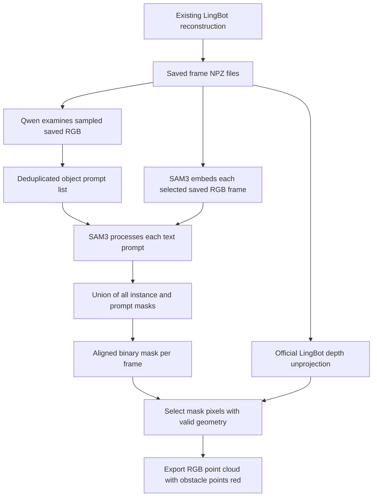

# Integrating the small-obstacle plugin with LingBot-Map

This report describes the implementation currently in this repository, including the revised VLM prompt and the latest evaluation. The integration is an optional post-processing pipeline: it reads saved LingBot predictions, discovers object concepts, produces one merged SAM mask per selected frame, and exports a point cloud with the corresponding scene surfaces marked red.

The integration point is **LingBot's saved per-frame RGB, depth, intrinsics and extrinsics**. The original LingBot reconstruction, existing SAM video script, and original single-prompt orchestrator remain unchanged. You can run the plugin after an existing reconstruction without loading the LingBot model again.

For the latest integration that feeds merged masks into the **unchanged original mapper**, see [the existing-pipeline runner](../plugins/small_obstacles/EXISTING_PIPELINE.md). It preserves the original mapping settings and records timing; the separate `project` stage described below remains available as an alternative.

## 1. Architecture and integration boundary



The three executable plugin stages are:

| Stage | Implementation | Input | Output |
| --- | --- | --- | --- |
| Propose | [propose.py](../plugins/small_obstacles/propose.py) | Saved RGB keyframes | `prompts.json` |
| Segment | [segment.py](../plugins/small_obstacles/segment.py) | Saved RGB frames and prompt list | `masks/frame_*.npz`, `masks/manifest.json` |
| Project | [project.py](../plugins/small_obstacles/project.py) | Original LingBot predictions and matching masks | `obstacle_map.ply` |

All stages are exposed through [the plugin CLI](../plugins/small_obstacles/__main__.py). [run_pipeline.sh](../plugins/small_obstacles/run_pipeline.sh) invokes them sequentially in separate processes.

Projection reuses these existing components:

| Existing component | Reused responsibility |
| --- | --- |
| [orchestrator/io_utils.py](../orchestrator/io_utils.py) | Load and normalize RGB, depth, confidence, intrinsics and extrinsics |
| [orchestrator/lingbot_geometry.py](../orchestrator/lingbot_geometry.py) | Call the official LingBot unprojection function |
| [orchestrator/pointcloud.py](../orchestrator/pointcloud.py) | Write binary XYZ/RGB PLY |
| [orchestrator/view_ply.py](../orchestrator/view_ply.py) | Display the resulting colored scene |

The plugin is an alternative semantic post-processing entry point alongside `orchestrator/main.py`. It does not feed its new mask filenames directly into the original single-prompt orchestrator, which expects its own naming and mask preprocessing conventions.

## 2. Input data contract

Use the prediction directory written by the existing [batch demo](../lingbot-map/demo_render/batch_demo.py) with `--save_predictions`:

```text
 data/lingbot_output/SCENE/
   frame_000000.npz
   frame_000001.npz
   ...
   meta.npz                 # Optional metadata; ignored by the plugin
```

Each selected `frame_*.npz` must contain:

| Key | Normalized shape | Meaning |
| --- | --- | --- |
| `images` | `H × W × 3`, uint8 RGB | The RGB image used for this reconstructed frame |
| `depth` | `H × W`, float32 | Camera-axis depth |
| `depth_conf` | `H × W`, float32 | LingBot depth confidence score |
| `intrinsic` | `3 × 3`, float32 | Intrinsics for the saved image resolution |
| `extrinsic` | `3 × 4`, float32 | World-to-camera transform |

Existing loaders also accept channel-first RGB, singleton depth dimensions, and 4×4 camera matrices. For example, the existing `IMG_5522` predictions have `images=(3,518,518)`, `depth=(518,518,1)`, `depth_conf=(518,518)`, `intrinsic=(3,3)` and `extrinsic=(3,4)`. That directory contains 672 saved frames.

Use one completed reconstruction as the source for a plugin run. Keep its predictions available and unchanged while masks are being generated and projected. Different reconstructions may use different coordinate frames or scale; a mask output folder should belong to one source reconstruction.

### Why the saved RGB matters

Both VLM discovery and production SAM segmentation read `images` from the saved NPZ files. They do not decode the original video again. This avoids differences caused by video rotation, frame extraction, resizing, center cropping and frame numbering.

SAM must operate on the saved RGB associated with the depth, rather than a separately decoded original-resolution image. Otherwise a pixel in the mask may correspond to a different surface in the depth map. No additional resize, crop, patch pooling, or intrinsic adjustment is required in the plugin because segmentation starts in the correct pixel coordinate system.

The saved image is already downsampled. Tiny objects that disappear at this resolution cannot be restored by prompt tuning or by the optional lower-half discovery crop.

## 3. VLM discovery and multiple-prompt behavior

The default model is `Qwen/Qwen3-VL-4B-Instruct`. The current prompt requests a factual ground description followed by short, concrete object names. It requires evidence that an object is loose, detached or displaced, and excludes normal terrain and installed infrastructure. Visible water bodies and actual open holes or ditches remain eligible categories.

An illustrative model response is:

```json
{
  "ground": "A gravel path with a log across it and a loose rock nearby.",
  "prompts": ["log", "rock"]
}
```

Only `prompts` are passed to SAM. The ground description is retained in the raw response for inspection.

The production discovery stage builds **one global concept list for the sequence**. It normalizes whitespace and case, deduplicates identical phrases, and includes concepts first discovered on later keyframes. It also saves the model, robot description, exact instruction, source directory, keyframe names and raw responses in `prompts.json`.

This has an important consequence: if `rock` is discovered on one keyframe, SAM receives `rock` on every selected segmentation frame. It is not restricted to the timestamp that produced that proposal. This helps detect the same class across the sequence, but can also mark unrelated matching instances elsewhere.

`--keyframe-step 30` selects every 30th file in the numerically sorted saved-frame list, starting with the first. It means saved predictions, not seconds or original video frames. If the saved input rate is 10 FPS, that corresponds to approximately three seconds; if it is 30 FPS, approximately one second. Establish the actual sampling rate from the reconstruction settings before interpreting the interval.

`--ground-crop` adds a lower-half discovery view. SAM still uses the full saved image. This option has not been evaluated in the latest full-video comparison.

The parser enforces a list of short nonempty strings, normalizes it and rejects malformed JSON. The current one-to-three-word and hazard-selection rules are model instructions, not a deterministic semantic filter. Invalid production responses stop discovery rather than silently proceeding with incomplete proposals. The evaluator instead records invalid responses for review.

## 4. SAM: many prompts, one mask per frame

For each selected frame, the segment stage:

1. Loads its saved RGB and computes SAM3 image features once.
2. Resets the previous prompt/results while retaining the image state.
3. Applies each text concept independently.
4. Unions all returned instance masks for that concept.
5. Unions the concept masks into one two-dimensional boolean mask.
6. Saves that mask using the original prediction filename.

If `S[t,p,i,v,u]` is the instance mask for frame `t`, prompt `p`, and instance `i`, the merged mask is:

```text
M[t,v,u] = OR over all prompts p and instances i of S[t,p,i,v,u]
```

Overlapping masks remain `True`; there are no class priorities. An empty detection contributes no pixels. If the global prompt list is empty, the stage writes all-false masks and skips loading SAM weights.

The production mask file contains:

```text
out_binary_masks   bool array, shape H × W
rgb_sha256         scalar string, SHA-256 of the normalized source RGB bytes
```

The stage also writes `manifest.json` containing `schema_version`, source prediction directory, prompt list, exact frame filenames, SAM threshold and alignment description. The manifest is written after segmentation completes. Projection reads only the filenames listed there, preventing stale unlisted files from entering the scene.

The production segment CLI retains the merged masks, not individual concept masks. The evaluation preview folder additionally contains individual prompt masks for analysis; this is a review artifact format rather than the standard production segment output.

`--frame-step 2` processes every second saved prediction; `--frame-step 1` processes all. CUDA inference uses bfloat16 autocast. The default SAM instance confidence threshold is 0.5; this is separate from LingBot's depth confidence threshold.

## 5. Mapping the mask into the scene

### Pixel to camera coordinates

For pixel `(u,v)`, depth `d = depth[v,u]`, focal lengths `(fx,fy)` and principal point `(cx,cy)`, the official helper computes:

```text
Xc = (u - cx) * d / fx
Yc = (v - cy) * d / fy
Zc = d
```

Here `u` is the column and `v` the row. Depth is camera-axis Z depth, not a Euclidean distance along the ray.

### Camera to world coordinates

The saved extrinsic is world-to-camera:

```text
Pc = R * Pw + t
```

Therefore the world point is:

```text
Pw = Rᵀ * (Pc - t)
```

The official [LingBot geometry implementation](../lingbot-map/lingbot_map/utils/geometry.py) performs the inverse internally. The plugin passes the saved extrinsic directly through `depth_to_world_points`. Do not invert it before this call or add another pose transform afterward.

The result is an `H × W × 3` world-point array. Its `[v,u]` entry corresponds directly to the mask's `[v,u]` entry. All frames use the world coordinates provided by that reconstruction.

### Geometry validity and semantic coloring

A selected pixel survives only when its world point, depth and confidence are finite, depth is positive, and the configured filters pass. Defaults are strict inequalities:

```text
valid = finite(world_point) AND finite(depth) AND depth > 0
        AND finite(depth_conf) AND depth_conf > 2.5 AND depth < 25

marked = valid AND merged_mask
```

Depth thresholds use the units of the saved reconstruction. The plugin does not calibrate scale, so the value 25 should not automatically be interpreted as 25 physical meters. Depth confidence is a model score, not an assumed probability in [0,1].

`--pixel-step` samples the point map, RGB, depth, confidence and mask identically. Its default is 1, which helps retain narrow/small objects. Larger values reduce point count but can skip thin hazards entirely.

Surviving masked points receive the configured obstacle color, red by default. Other surviving points retain their RGB. Frame point sets are concatenated and written to PLY. No new depth is estimated, no object volume is filled, and no additional fusion or point averaging is performed.

A code sketch of the existing mapping operation is:

```python
points_map = depth_to_world_points(depth, intrinsic, extrinsic)
valid = (
    np.isfinite(points_map).all(axis=-1)
    & np.isfinite(depth) & (depth > 0)
    & np.isfinite(confidence)
    & (confidence > 2.5) & (depth < 25)
)
points = points_map[valid]
colors = rgb[valid].copy()
colors[merged_mask[valid]] = [255, 0, 0]
```

This sketch omits the implemented hash, shape and sampling checks; use the project CLI for actual processing.

### Meaning of the resulting map

`obstacle_map.ply` contains the complete valid geometry from the selected frames, with mask-selected surfaces marked red. It is a new semantic scene export, rather than an in-place update of an existing PLY or LingBot's internal state.

The PLY stores XYZ and RGB only. It does not store an explicit `non_traversable` property, class IDs, object IDs or point-to-frame provenance. The binary masks are the authoritative saved semantic observations. Natural red RGB pixels can match the marking color, so downstream software should not infer a reliable boolean label solely by testing RGB equality.

If an existing map consumer already reads XYZ/RGB PLY, it can display this export using its current loader. If it needs explicit semantic labels, add a separate downstream exporter or consumer adapter that preserves `merged_mask[valid]` alongside XYZ. Such an adapter is not currently implemented and does not require changing the reconstruction core.

The projection cannot attach a label to a point that has no valid depth. For water, reflections may produce uncertain or incorrect depth; for an open hole, visible pixels may reconstruct the bottom or far side, while empty space has no surface point to mark. The current output marks reconstructed visible surfaces, not a filled forbidden volume or inferred hole footprint.

## 6. Running the integration

Run the following commands from the repository root. Environment names below follow the existing project conventions; activate your actual environments if their names differ.

### A. Generate or reuse LingBot predictions

Skip reconstruction if the required prediction directory already exists. For a new reconstruction, the existing batch implementation can save the required files without rendering a video:

```bash
conda activate lingbot-map
python lingbot-map/demo_render/batch_demo.py \
  --video_path data/videos/indoor/IMG_5522.mp4 \
  --output_folder data/lingbot_output \
  --model_path lingbot-map/lingbot-map.pt \
  --mode windowed \
  --window_size 32 \
  --keyframe_interval 2 \
  --num_scale_frames 2 \
  --overlap_keyframes 8 \
  --use_sdpa \
  --no_render \
  --save_predictions
```

This is the existing reconstruction configuration with rendering disabled; it is not a new recommended accuracy configuration. Preserve whichever reconstruction settings work for your scene. If using a render preset from the root directory, its path is `lingbot-map/demo_render/config/indoor.yaml`.

The saved directory is `data/lingbot_output/IMG_5522`, not `IMG_5522.npz`. The plugin requires per-frame files. Existing monolithic prediction archives need conversion to this contract or regeneration through the existing per-frame save workflow.

### B. Discover prompts

In your VLM environment with a compatible PyTorch/torchvision installation:

```bash
python -m pip install -r plugins/small_obstacles/requirements-vlm.txt

python -m plugins.small_obstacles propose \
  --lingbot-dir data/lingbot_output/IMG_5522 \
  --output data/small_obstacles/IMG_5522/prompts.json \
  --model Qwen/Qwen3-VL-4B-Instruct \
  --keyframe-step 30 \
  --robot "a small wheeled ground robot"
```

The requirements file installs the VLM-side Python dependencies; it does not set up CUDA or guarantee compatibility of an existing torch/torchvision pair. The workspace evaluation required `PYTHONNOUSERSITE=1` to avoid conflicting user-site packages, and temporarily loaded Accelerate from `/tmp/small-obstacles-vlm-deps`. That temporary directory is an evaluation workaround, not an installation dependency for deploying the plugin.

Inspect `prompts.json` before diagnosing a segmentation problem. You can edit its `prompts` list or supply a manual JSON list such as `["log", "rock"]`. Editing prompts requires rerunning segmentation and projection.

### C. Generate merged masks

```bash
conda activate sam3
python -m plugins.small_obstacles segment \
  --lingbot-dir data/lingbot_output/IMG_5522 \
  --prompts data/small_obstacles/IMG_5522/prompts.json \
  --output-dir data/small_obstacles/IMG_5522/masks \
  --frame-step 2 \
  --sam-threshold 0.5 \
  --device cuda
```

Use `--checkpoint /absolute/path/to/sam3.pt` if using a local checkpoint. The implementation prefers the existing source checkout at `sam3/`. In this workspace the validated SAM interpreter is `/opt/conda/envs/sam3/bin/python`.

### D. Project into the scene

```bash
conda activate orchestrator
python -m plugins.small_obstacles project \
  --lingbot-dir data/lingbot_output/IMG_5522 \
  --masks-dir data/small_obstacles/IMG_5522/masks \
  --output data/small_obstacles/IMG_5522/obstacle_map.ply \
  --pixel-step 1 \
  --min-depth-conf 2.5 \
  --max-depth 25 \
  --color 255,0,0
```

This stage needs the existing geometry dependencies and LingBot source, but loads neither VLM nor SAM weights. Use `--min-depth-conf none` or `--max-depth none` to disable a filter for diagnosis. Review the geometry before adopting weaker filters for a full export.

### E. Inspect the scene

```bash
python orchestrator/view_ply.py \
  data/small_obstacles/IMG_5522/obstacle_map.ply \
  --port 8080 \
  --max-points 0
```

The existing viewer starts a Viser server. Forward port 8080 or use the platform's port proxy when running remotely. `--max-points 0` displays all points; the default samples up to 500,000 points, which can hide sparse small-object markings. Increase sampling limits only as your browser can handle. Viewer up-direction settings affect display orientation; they do not transform the exported coordinates.

### F. Run all plugin stages through the wrapper

```bash
VLM_PYTHON=/path/to/vlm-env/bin/python \
SAM_PYTHON=/path/to/sam3-env/bin/python \
PROJECT_PYTHON=/path/to/orchestrator-env/bin/python \
KEYFRAME_STEP=30 \
FRAME_STEP=2 \
bash plugins/small_obstacles/run_pipeline.sh \
  data/lingbot_output/IMG_5522 \
  data/small_obstacles/IMG_5522
```

The wrapper reuses existing predictions; it does not run LingBot. Supported environment settings are the three interpreter paths plus `VLM_MODEL`, `KEYFRAME_STEP`, and `FRAME_STEP`. Custom thresholds, checkpoint paths, discovery crops and frame limits require the individual stage commands. Each process exits before the next begins, releasing its model memory.

## 7. Outputs, alignment checks and reruns

A production run produces:

```text
 data/small_obstacles/SCENE/
   prompts.json
   masks/
     manifest.json
     frame_000000.npz
     frame_000002.npz
     ...
   obstacle_map.ply
```

The correspondence is filename-exact: `masks/frame_000002.npz` describes `LINGBOT_DIR/frame_000002.npz`.

Before unprojection, the project stage compares the source RGB hash and requires mask, RGB, depth and confidence to have exactly matching spatial dimensions. It rejects invalid manifest filenames and uses the manifest's completed frame list. It then checks the shape of the world-point map returned by the official helper.

The RGB hash proves image identity after normalization; it does **not** fingerprint depth, intrinsics or extrinsics. If those arrays change while RGB remains identical, the existing hash check will not detect it. Keep prediction sets immutable for a run, and use separate output directories when comparing reconstructions or running concurrent jobs.

The recorded source path is provenance; the hash and array shapes are the active alignment checks. Projection does not require the same path string if the data were copied elsewhere. Segmentation protects against using the prediction directory itself as the mask output directory.

If only projection thresholds or obstacle color change, rerun `project`. If prompts or SAM thresholds change, rerun `segment` and `project`. If the reconstruction changes, regenerate masks and projection from that prediction set.

Repeated world observations are concatenated. A surface can appear as red in one observation and original RGB in another, and adjacent frame masks can flicker. There is no persistent semantic fusion, temporal tracking, or deduplication in this export.

## 8. Validation status and deployment checks

The latest VLM rerun covered all 18 videos: 5 indoor and 13 outdoor, with 150 sampled frames. It produced 150 valid JSON responses and 13 nonempty proposal frames. SAM was run on all 13 of those frames and produced nonempty masks for all 13 applications.

Visual review confirmed retention of the nine earlier log detections and removal of the observed false proposals for ordinary vegetation, maintained gravel, installed steps and a closed cover. The simpler `stone block` prompt detected the displaced block previously missed by `tilted stone block`, but also selected upright fixed blocks in two frames. Small-fragment recall remains unresolved.

Those evaluation masks were generated from saved evaluation images, not from saved depth-bearing predictions for every video. They have not all been projected into reconstructed maps. Also, the evaluator uses each frame's proposals, while production uses the sequence-wide union of discovered concepts. Sequence-wide cross-frame matching can introduce additional false masks, so frame-level evaluation is not a complete production-pipeline accuracy measurement.

Geometry and file contracts are covered by the existing seven plugin tests, including multi-prompt and multi-instance union, empty detections, changed-source rejection, depth filtering and projection through the actual official LingBot helper. Earlier smoke runs also exercised real SAM on existing depth-bearing predictions and scene export. The latest outdoor mask review is separate from those geometry checks.

To run the implementation checks:

```bash
python -m unittest discover -s plugins/small_obstacles/tests -v
```

For an integration smoke run, use a new output directory and apply `--max-frames 8` to both discovery and segmentation, with `--keyframe-step 1` and `--frame-step 1`. Project that completed eight-frame manifest and inspect its masks alongside the red scene surfaces. The two frame limits are independent; a limit on discovery alone does not limit segmentation.

For a useful positive projection check, use saved predictions containing a visible log, loose object or stone fragment. A clean corridor can verify the empty-mask path but cannot validate that obstacle points are marked correctly.

Review the source image, mask, surviving depth/confidence pixels and 3D result together. A visually correct 2D mask can still produce few or no marked points if depth is missing or filtered. Conversely, a precise mask of normal gravel still produces a wrong obstacle annotation if the VLM selected the wrong concept.

Useful failure diagnoses:

| Symptom | Likely checks |
| --- | --- |
| No objects proposed | Discovery sampling, actual visibility, saved RGB resolution, raw response |
| Nonempty proposals but empty masks | SAM-compatible noun, checkpoint, confidence threshold, source image |
| Correct masks but no red scene points | Depth/confidence validity, maximum depth, pixel sampling |
| Red regions shifted from objects | Source prediction identity and pose convention; do not add a second inverse |
| Normal terrain marked | VLM concept relevance and unrelated instances selected by a global concept |
| Duplicated or mixed-color surfaces | Concatenated observations and absent temporal semantic fusion |
| Sparse markings missing in viewer | Viewer point sampling before changing masks or reconstruction |

Water/open-hole performance is not validated by the available positive sampled examples. The implementation supplies a semantic surface overlay for inspection and downstream use; it does not implement path planning or infer a complete physical traversability model.

## 9. Existing artifacts

- [Plugin usage README](../plugins/small_obstacles/README.md)
- [Latest VLM evaluation](../data/small_obstacles/evaluation/improved_4b/index.html)
- [Paired prompt comparison and mask analysis](../data/small_obstacles/evaluation/improved_4b/analysis.md)
- [All latest proposal-mask previews in one folder](../data/small_obstacles/evaluation/improved_proposal_masks/index.html)
- [Combined mask preview](../data/small_obstacles/evaluation/improved_proposal_masks/all_proposals.jpg)
- [Earlier projection smoke-test PLY](../data/small_obstacles/IMG_5522_smoke/obstacle_map.ply)

The earlier smoke-test scene is not a projection of the latest outdoor proposals. Use the production commands above to generate a scene export for a chosen completed LingBot reconstruction.

## Appendix: current deployed VLM instruction

The robot placeholder is replaced with the `--robot` argument. By default it is `a small wheeled ground robot`.

```text
Describe the visible ground, then identify visible hazards for
Robot: {robot}. Return only JSON with "ground" (one factual sentence) and
"prompts" (a list of short object names for SAM3).

Include an object only when it is visibly loose, detached or displaced on the
ground where the robot could travel. Also include visibly identifiable bodies
of water and actual open holes or ditches. Do not assume an object is hazardous
merely because it is visible. A detached log across a path qualifies.

Exclude normal terrain and installed infrastructure: maintained gravel paths,
grass or vegetation alone, scattered leaves, intact pavement, paving stones,
installed path slabs or steps, and closed flush drain or manhole covers.
Joints, cracks or shadows alone do not make a slab broken or a hole open.
Exclude furniture, buildings, fixed posts and objects on tables. A loose rock
or displaced fragment qualifies; the intact surface underneath it does not.

Use distinct lowercase conventional object nouns of one to three words.
Name the object itself, without color, position, size or pose: use "stone block"
rather than "tilted stone block". Do not use vague labels such as "debris",
"fragment", "gravel debris", "obstacle" or "overgrown grass". If the specific
object type or its loose/displaced status is unclear, omit it. Never invent
water or holes from stains or shadows. Do not copy examples unless visible.
If no qualifying hazard is visible, "prompts" must be []. Do not speculate.
```
